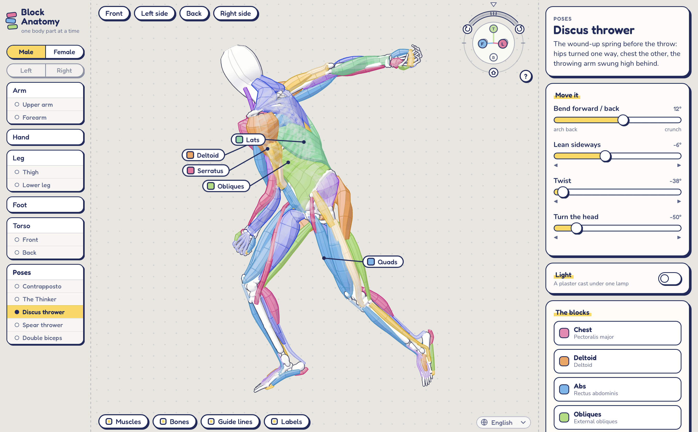
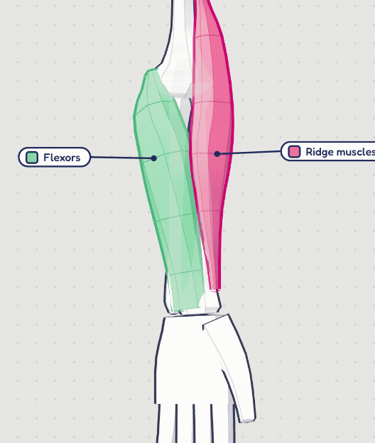
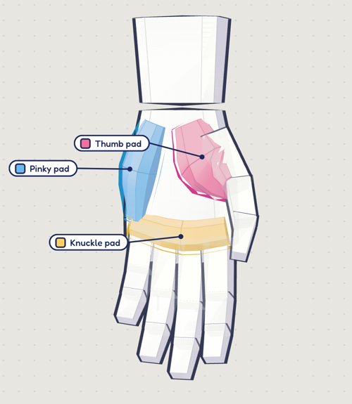
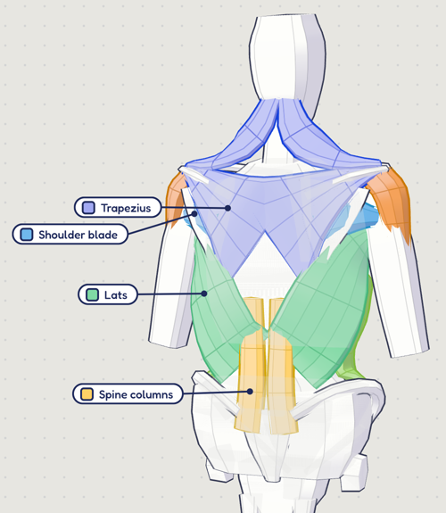
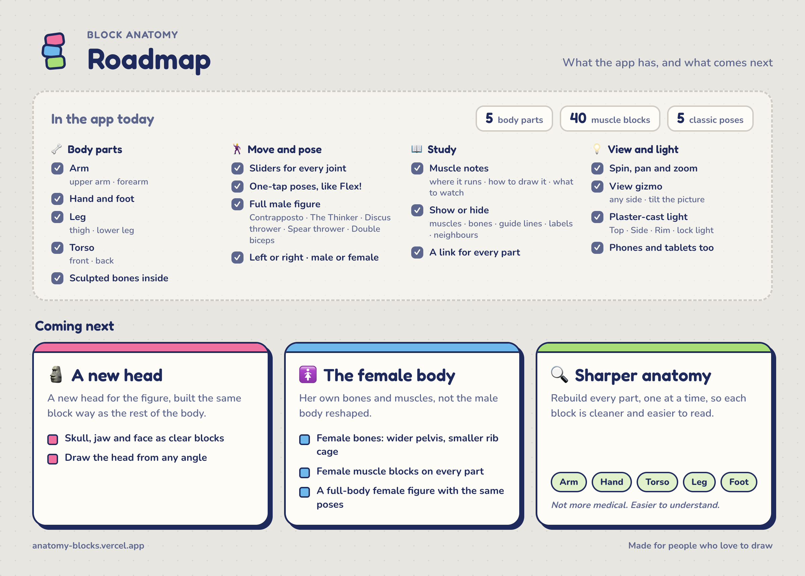

<div align="center">


# Block Anatomy

<p>
<b>Big, simple muscle blocks that help beginners see the body's shape and draw it in any pose.</b>
<br />
<small>Shapes first, details later.</small>
</p>

<p>
<a href="LICENSE"></a>
<a href="https://github.com/milesyan-art/anatomy-blocks/stargazers"></a>
<a href="README.md"></a>
<a href="README.zh-CN.md"></a>
</p>

<p>
<a href="https://anatomy-blocks.vercel.app"></a>
<br />
<small>Free · runs in your browser · no sign-up · works on iPad & phones</small>
</p>

</div>

<details>
<summary><b>📖 Table of contents</b></summary>

- [🎨 Why Block Anatomy](#-why-block-anatomy)
- [✨ Features](#-features)
- [🦴 Body parts](#-body-parts)
- [🚀 Get started](#-get-started)
- [🗺️ Roadmap](#️-roadmap)
- [🙋 Questions](#-questions)

</details>

## 🎨 Why Block Anatomy



Most anatomy references show every muscle. Beginners don't need that. Block Anatomy turns each muscle group into **one simple block**, so you see the big shapes first and draw the body right in any pose.

<table>
<tr>
<td width="33%" valign="top">🧩 <b>Big shapes first</b><br />Only the muscles that shape the surface, each as one clear block.</td>
<td width="33%" valign="top">🔄 <b>See them move</b><br />Bend or twist a joint and the blocks stretch, bunch and wrap.</td>
<td width="33%" valign="top">✏️ <b>Made for drawing</b><br />Notes on how to draw each block, not medical detail.</td>
</tr>
</table>

<br />

## ✨ Features

<p align="center">

<br />
<sub>Turn the palm down and the forearm blocks wrap like a towel being wrung out.</sub>
</p>

<table>
<tr>
<td width="50%" valign="top">🎚️ <b>Pose any joint</b><br />Sliders and one-tap poses like <i>Flex!</i>, <i>Fist</i> or <i>Tiptoe</i>.</td>
<td width="50%" valign="top">🧭 <b>View from any angle</b><br />Spin freely, jump to front, back or side, or tilt the picture like a sketchbook.</td>
</tr>
<tr>
<td valign="top">📖 <b>Muscle notes</b><br />Click a block to see where it runs and how to draw it.</td>
<td valign="top">💡 <b>Plaster light</b><br />Light the model like a cast in class and study its light and shadow.</td>
</tr>
<tr>
<td valign="top">🙈 <b>Layers</b><br />Show or hide muscles, bones, guide lines and labels.</td>
<td valign="top">🚻 <b>Body and side</b><br />Switch male or female, and the left or right limb.</td>
</tr>
</table>

<br />

## 🦴 Body parts

<table>
<tr>
<td align="center" width="25%"><a href="https://anatomy-blocks.vercel.app/#forearm"></a><br /><sub><b>Forearm</b></sub></td>
<td align="center" width="25%"><a href="https://anatomy-blocks.vercel.app/#hand"></a><br /><sub><b>Hand</b></sub></td>
<td align="center" width="25%"><a href="https://anatomy-blocks.vercel.app/#leg"></a><br /><sub><b>Whole leg</b></sub></td>
<td align="center" width="25%"><a href="https://anatomy-blocks.vercel.app/#torso-back"></a><br /><sub><b>Torso back</b></sub></td>
</tr>
</table>

<p align="center">
<b>Arm</b> <a href="https://anatomy-blocks.vercel.app/#forearm">Forearm</a> · <a href="https://anatomy-blocks.vercel.app/#upper-arm">Upper arm</a> · <a href="https://anatomy-blocks.vercel.app/#arm">Whole arm</a> · <a href="https://anatomy-blocks.vercel.app/#hand">Hand</a>
<br />
<b>Leg</b> <a href="https://anatomy-blocks.vercel.app/#thigh">Thigh</a> · <a href="https://anatomy-blocks.vercel.app/#lower-leg">Lower leg</a> · <a href="https://anatomy-blocks.vercel.app/#leg">Whole leg</a> · <a href="https://anatomy-blocks.vercel.app/#foot">Foot</a>
<br />
<b>Torso</b> <a href="https://anatomy-blocks.vercel.app/#torso-front">Front</a> · <a href="https://anatomy-blocks.vercel.app/#torso-back">Back</a>
</p>

<br />

## 🚀 Get started

1. **[Open the app](https://anatomy-blocks.vercel.app).** Nothing to install.
2. **Pick a body part** from the list on the left.
3. **Drag** to spin, **move a slider** to pose, and **click a block** to read about it. The **?** button lists every shortcut.

<br />

## 🗺️ Roadmap



<br />

## 🙋 Questions

<details>
<summary><b>Is this good enough for medical study?</b></summary>
<br />
No. It is simplified on purpose. Muscles are grouped and shaped as blocks to
help you draw, not to be anatomically exact.
</details>

<details>
<summary><b>Can I see the right arm or leg?</b></summary>
<br />
Yes. Use the <b>Left · Right</b> switch under <i>Male / Female</i>. It works for
arms, hands, legs and feet, and the view buttons still point the right way. The
torso already shows both sides, so the switch is greyed out there.
</details>

<details>
<summary><b>Does it work on my phone or tablet?</b></summary>
<br />
Yes. Drag with one finger to spin and pinch to zoom. Twist two fingers to tilt the picture.
</details>

<details>
<summary><b>Can I share a link to one body part?</b></summary>
<br />
Yes. Every part has its own link, like
<a href="https://anatomy-blocks.vercel.app/#hand">anatomy-blocks.vercel.app/#hand</a>.
The links under <i>Body parts</i> work the same way.
</details>

<br />

---

<details>
<summary><b>🛠️ For developers</b></summary>
<br />

Block Anatomy is a small static site built with React, Vite and three.js. To
run it on your computer:

```bash
npm install
npm run dev
```

`npm run build` makes a production build in `dist/`. The live site is deployed
by Vercel from the `main` branch.

</details>

<div align="center">
<br />
<sub>Made with 🎨 for people who love to draw.</sub>
</div>
