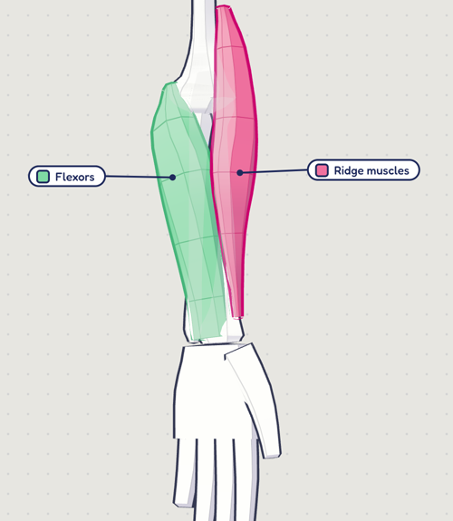
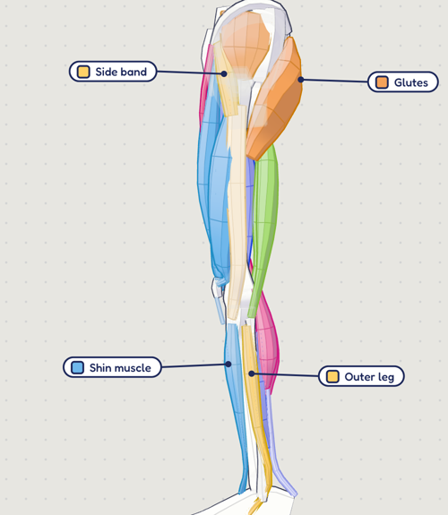

<div align="center">


# Block Anatomy

**Learn the muscles that matter for drawing, one body part at a time.**

### 👉 [Open Block Anatomy](https://anatomy-blocks.vercel.app) 👈

Runs in your browser · no sign-up · works on phones too

**English** · [简体中文](README.zh-CN.md)

<br />


</div>

<br />

## 🧱 What is this?

Real anatomy is a tangle of tiny muscles. When you draw, you don't need all of
them. You need the **big shapes** that push out the skin.

Block Anatomy shows each body part as a white mannequin with a few simple,
coloured **muscle blocks** on top. Move a slider and the blocks stretch, bunch
up and wrap around, just like the real thing. Spin it around, look from any
side, and click a block to learn how to draw it.

It's made for **artists**, not doctors. Only the muscles that change the
surface are included.

<br />

<table>
<tr>
<td width="46%" align="center">

</td>
<td>

### 🔄 Bend it. Twist it. Watch.

Turn your palm down and the forearm muscles **wrap around** like a towel being wrung out. Bend the elbow and the biceps **bunches up**.

Seeing *why* a shape changes is the fastest way to draw it from imagination.

</td>
</tr>
</table>

<br />

## 🚀 Start in 30 seconds

1. **[Open the app.](https://anatomy-blocks.vercel.app)** Nothing to install.
2. **Pick a body part** from the list on the left. For an arm or leg, choose
   **Left** or **Right**.
3. **Drag** to spin it. **Right-drag** (or **Shift + drag**) to pan. **Scroll** or **pinch** to zoom. The **?** under the view gizmo lists every shortcut.
4. **Move the sliders** on the right, or tap a pose button like *Flex!*
5. **Click any coloured block** to read about it.

<br />

## 🦴 Pick a body part

Each link opens that part straight away.

| | Body part | Try these poses |
| :-: | --- | --- |
| 💪 | **Arm:** [Forearm](https://anatomy-blocks.vercel.app/#forearm) · [Upper arm](https://anatomy-blocks.vercel.app/#upper-arm) · [Whole arm](https://anatomy-blocks.vercel.app/#arm) | Palm up · Palm down · Thumb up · Flex! |
| ✋ | **Hand:** [Hand](https://anatomy-blocks.vercel.app/#hand) | Relaxed · Flat · Grip · Fist |
| 🦵 | **Leg:** [Thigh](https://anatomy-blocks.vercel.app/#thigh) · [Lower leg](https://anatomy-blocks.vercel.app/#lower-leg) · [Whole leg](https://anatomy-blocks.vercel.app/#leg) | Standing · Tiptoe · Sitting · Deep bend |
| 🦶 | **Foot:** [Foot](https://anatomy-blocks.vercel.app/#foot) | Flat · Tiptoe · Pointed · Flexed |
| 🧍 | **Torso:** [Front](https://anatomy-blocks.vercel.app/#torso-front) · [Back](https://anatomy-blocks.vercel.app/#torso-back) | Upright · Crunch · Arch · Side bend · Twist |

<br />

<table>
<tr>
<td align="center"><br /><sub><b>Forearm</b></sub></td>
<td align="center"><br /><sub><b>Hand</b></sub></td>
<td align="center"><br /><sub><b>Whole leg</b></sub></td>
<td align="center"><br /><sub><b>Torso back</b></sub></td>
</tr>
</table>

<br />

## 🧰 Your toolbox

| | Tool | What it does |
| :-: | --- | --- |
| 🎚️ | **Move it** | Sliders and one-tap poses for each joint. |
| 👀 | **Look from** | Four buttons jump to the front, back and sides. You can also drag to spin freely. |
| 🧭 | **View gizmo** | The ball in the top-right corner. Click a dot to look from that side, including the top and from below, or drag the ball to turn the model. Drag the **arc** above it to **tilt the picture**, the way you turn your sketchbook to draw a line at a comfortable angle. The arrows at its ends tilt 15° at a time, or press **Q** / **E**. Once tilted, the little mark at the top turns yellow: click it to level the picture. The button at the bottom goes back to the starting view. |
| 📖 | **Muscle notes** | Click a block to highlight it. You'll see *where* it runs, how to *draw it*, and what to *watch* when it moves. |
| ↔️ | **Left / Right** | Choose the left or right limb. Works for arms, hands, legs and feet. |
| 🚻 | **Male / Female** | The female figure has a narrower rib cage and shoulders, a smaller waist, wider hips, slimmer muscles and a breast shape on the chest. |
| 🙈 | **Show and hide** | Switch on or off: *Muscles*, *Bones*, *Guide lines*, *Labels* and *Neighbours* (the muscles next door). Hide *Muscles* to study the plain mannequin, or hide *Bones* to see only the muscles. |
| 💡 | **Light** | Off by default. Turn it on and the model becomes a **plaster cast under one lamp**, on a studio backdrop, like the casts you draw in class. Every form shows the full value range: highlight, light, halftone, core shadow, reflected light, and cast shadows where one form blocks the lamp from another. Drag the little sun around the ball to move the lamp, pick a preset like *Top*, *Side* (split light) or *Rim* (from behind), set how hard the lamp is, and switch between *Plaster* and *Colour* (keeps the muscle colours). Turn on *Lock light* to keep the lamp where it is while you turn the model, like walking round a cast in class. |
| 🌏 | **Language** | English or 简体中文. It follows your browser the first time and remembers your choice. |

<br />

## 🙋 Questions

<details>
<summary><b>Is this good enough for medical study?</b></summary>
<br />
No. It is simplified on purpose. Muscles are grouped and shaped as blocks to
help you draw, not to be anatomically exact.
</details>

<details>
<summary><b>Can I see the right arm or leg?</b></summary>
<br />
Yes. Use the <b>Left · Right</b> switch under <i>Male / Female</i>. It works for
arms, hands, legs and feet, and the view buttons still point the right way. The
torso already shows both sides, so the switch is greyed out there.
</details>

<details>
<summary><b>Does it work on my phone or tablet?</b></summary>
<br />
Yes. Drag with one finger to spin and pinch to zoom. Twist two fingers to tilt the picture.
</details>

<details>
<summary><b>Can I share a link to one body part?</b></summary>
<br />
Yes. Every part has its own link, like
<a href="https://anatomy-blocks.vercel.app/#hand">anatomy-blocks.vercel.app/#hand</a>.
The links in the table above work the same way.
</details>

<br />

---

<details>
<summary><b>🛠️ For developers</b></summary>
<br />

Block Anatomy is a small static site built with React, Vite and three.js. To
run it on your computer:

```bash
npm install
npm run dev
```

`npm run build` makes a production build in `dist/`. The live site is deployed
by Vercel from the `main` branch.

</details>

<div align="center">
<br />
<sub>Made with 🧱 for people who love to draw.</sub>
</div>
