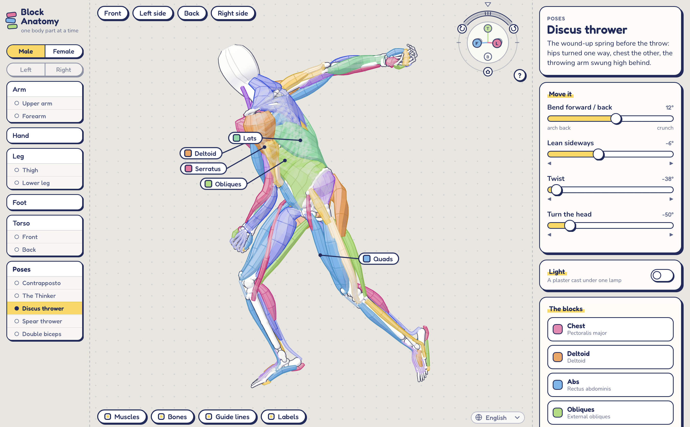
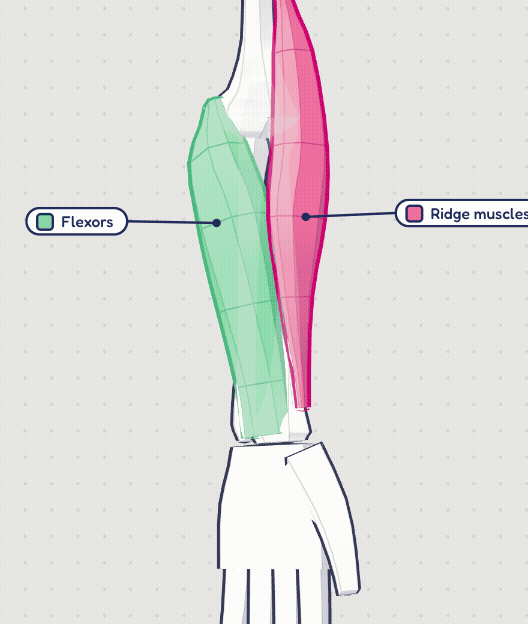
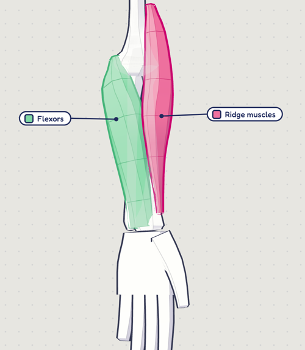
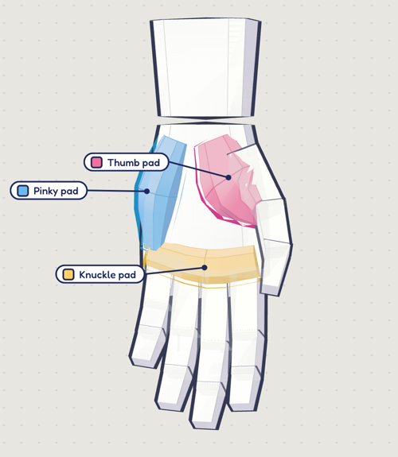
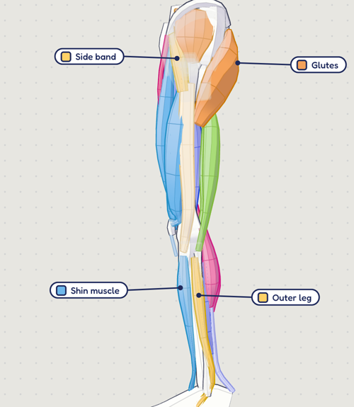
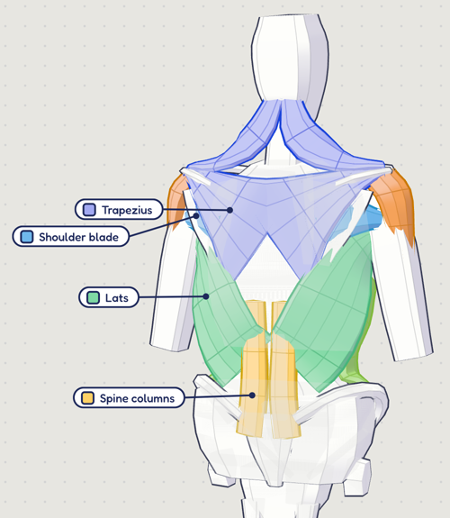
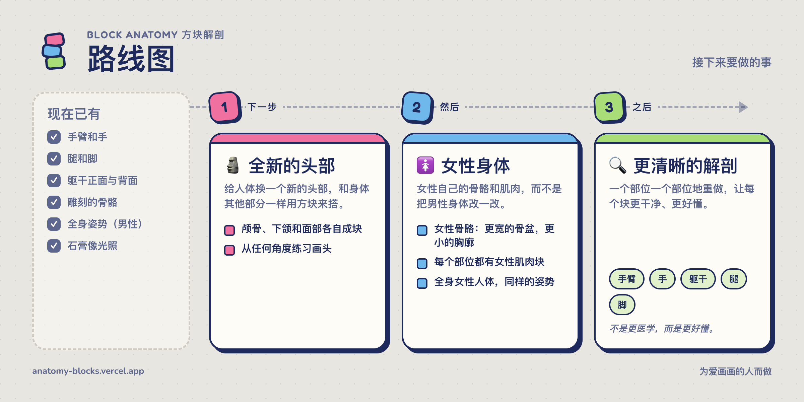

<div align="center">


# 方块解剖 Block Anatomy

<p>
<b>用简单的大块肌肉，帮新手看清身体的形状，画准任何动作。</b>
<br />
<small>先抓大形，再抠细节。</small>
</p>

<p>
<a href="LICENSE"></a>
<a href="https://github.com/milesyan-art/anatomy-blocks/stargazers"></a>
<a href="README.md"></a>
<a href="README.zh-CN.md"></a>
</p>

<p>
<a href="https://anatomy-blocks.vercel.app"></a>
<br />
<small>免费 · 浏览器里直接用 · 不用注册 · iPad 和手机都能用</small>
</p>

</div>

<details>
<summary><b>📖 目录</b></summary>

- [🎨 为什么做方块解剖](#-为什么做方块解剖)
- [✨ 功能](#-功能)
- [🦴 部位](#-部位)
- [🚀 快速上手](#-快速上手)
- [🗺️ 路线图](#️-路线图)
- [🙋 常见问题](#-常见问题)

</details>

## 🎨 为什么做方块解剖



大多数解剖资料会画出每一块肌肉，新手其实用不上。方块解剖把每组肌肉变成**一块简单的方块**，让你先看清大形，再把任何动作画准。

<table>
<tr>
<td width="33%" valign="top">🧩 <b>先抓大形</b><br />只保留影响体表的肌肉，每组一块清楚的方块。</td>
<td width="33%" valign="top">🔄 <b>看它怎么动</b><br />弯一弯、扭一扭关节，方块会拉长、鼓起、缠绕。</td>
<td width="33%" valign="top">✏️ <b>为画画而做</b><br />每块都告诉你怎么画，不讲医学细节。</td>
</tr>
</table>

<br />

## ✨ 功能

<p align="center">

<br />
<sub>把掌心翻向下，前臂的方块会像拧毛巾一样缠绕起来。</sub>
</p>

<table>
<tr>
<td width="50%" valign="top">🎚️ <b>摆任何姿势</b><br />每个关节都有滑块和一键姿势，比如<i>秀肌肉！</i>、<i>握拳</i>、<i>踮脚</i>。</td>
<td width="50%" valign="top">🧭 <b>任意角度看</b><br />自由旋转，一键看正面、背面、侧面，还能像转速写本一样倾斜画面。</td>
</tr>
<tr>
<td valign="top">📖 <b>肌肉说明</b><br />点一下方块，看它在哪里、怎么画。</td>
<td valign="top">💡 <b>石膏光影</b><br />像课堂上画石膏像一样打一盏灯，研究明暗。</td>
</tr>
<tr>
<td valign="top">🙈 <b>图层</b><br />显示或隐藏肌肉、骨架、辅助线和标签。</td>
<td valign="top">🚻 <b>体型和左右</b><br />切换男性或女性，选择左侧或右侧肢体。</td>
</tr>
</table>

<br />

## 🦴 部位

<table>
<tr>
<td align="center" width="25%"><a href="https://anatomy-blocks.vercel.app/#forearm"></a><br /><sub><b>前臂</b></sub></td>
<td align="center" width="25%"><a href="https://anatomy-blocks.vercel.app/#hand"></a><br /><sub><b>手</b></sub></td>
<td align="center" width="25%"><a href="https://anatomy-blocks.vercel.app/#leg"></a><br /><sub><b>整条腿</b></sub></td>
<td align="center" width="25%"><a href="https://anatomy-blocks.vercel.app/#torso-back"></a><br /><sub><b>躯干背面</b></sub></td>
</tr>
</table>

<p align="center">
<b>手臂</b> <a href="https://anatomy-blocks.vercel.app/#forearm">前臂</a> · <a href="https://anatomy-blocks.vercel.app/#upper-arm">上臂</a> · <a href="https://anatomy-blocks.vercel.app/#arm">整条手臂</a> · <a href="https://anatomy-blocks.vercel.app/#hand">手</a>
<br />
<b>腿</b> <a href="https://anatomy-blocks.vercel.app/#thigh">大腿</a> · <a href="https://anatomy-blocks.vercel.app/#lower-leg">小腿</a> · <a href="https://anatomy-blocks.vercel.app/#leg">整条腿</a> · <a href="https://anatomy-blocks.vercel.app/#foot">脚</a>
<br />
<b>躯干</b> <a href="https://anatomy-blocks.vercel.app/#torso-front">正面</a> · <a href="https://anatomy-blocks.vercel.app/#torso-back">背面</a>
</p>

<br />

## 🚀 快速上手

1. **[打开网站](https://anatomy-blocks.vercel.app)**，不用安装。
2. 在左侧列表里**选一个部位**。
3. **拖动**旋转，**拖滑块**摆姿势，**点方块**看说明。**?** 按钮里有全部快捷键。

<br />

## 🗺️ 路线图



<br />

## 🙋 常见问题

<details>
<summary><b>可以用来学医学解剖吗？</b></summary>
<br />
不行。它是故意简化过的：肌肉被合并、做成方块，是为了帮助画画，不追求解剖上的精确。
</details>

<details>
<summary><b>能看右手、右腿吗？</b></summary>
<br />
能。用“男 / 女”下面的 <b>左 · 右</b> 开关就行，手臂、手、腿、脚都可以用，视角按钮也会跟着对应过去。躯干本来就显示两侧，所以在躯干课程里这个开关是灰色的。
</details>

<details>
<summary><b>手机和平板能用吗？</b></summary>
<br />
能。单指拖动旋转，双指缩放，双指扭转可以倾斜画面。
</details>

<details>
<summary><b>可以分享某个部位的链接吗？</b></summary>
<br />
可以。每个部位都有自己的链接，比如 <a href="https://anatomy-blocks.vercel.app/#hand">anatomy-blocks.vercel.app/#hand</a>。<i>部位</i>一节里的链接也是这样。
</details>

<br />

---

<details>
<summary><b>🛠️ 给开发者</b></summary>
<br />

方块解剖是一个用 React、Vite 和 three.js 做的小型静态网站。在本地运行：

```bash
npm install
npm run dev
```

`npm run build` 会把生产版本构建到 `dist/`。线上版本由 Vercel 从 `main` 分支自动部署。

</details>

<div align="center">
<br />
<sub>用 🎨 为爱画画的人制作。</sub>
</div>
